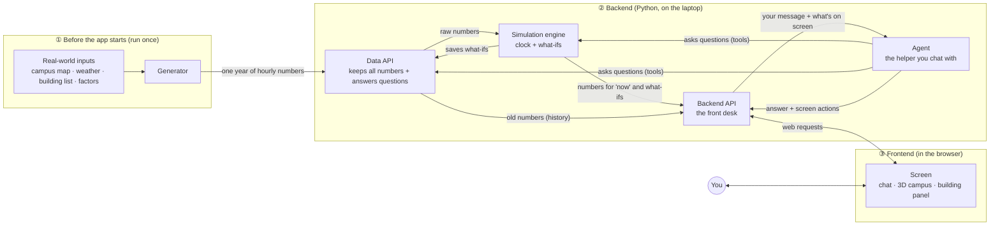
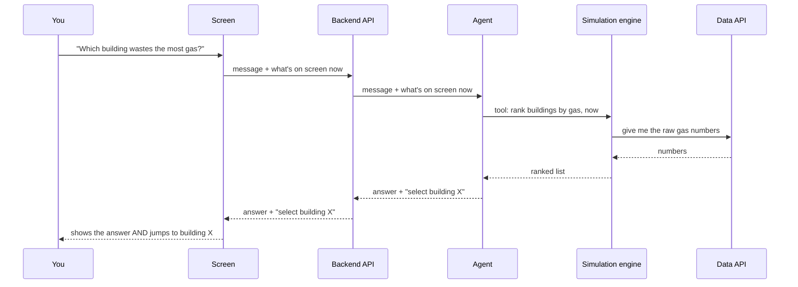

# How data moves through the app

This page shows where every number in the app comes from and where it goes.
If you only read one page, read this one.

## The big picture

There are three zones, and you read them from left to right:

1. **Before the app starts.** The Generator makes up a believable year of data for the campus. It runs once and then stops.
2. **Backend.** This is where the numbers live and where the thinking happens.
3. **Frontend.** What you see and click.

**The one rule that keeps it simple:** the screen never talks to the data directly.
Everything goes through the Backend API, like ordering at a counter instead of walking into the kitchen.

## What happens when…

### …you open the app

1. The screen asks the Backend API: "Which buildings are there, and what time is it?"
2. The Backend API asks the Data API for the building list and asks the Simulation engine for the time.
3. The screen draws the 3D campus and shows the clock.

### …you click a building

1. The screen says: "Building X was selected."
2. It asks the Backend API: "What are building X's numbers right now?"
3. The Simulation engine takes building X's raw numbers from the Data API, picks the ones for "now",
   and applies any what-if that's switched on.
4. The building panel on the right shows the result.

### …you ask the Agent a question

The Agent can't see the screen. The screen tells it what's showing (which building, which tab, what time).
The Agent also can't touch the screen. It sends back **screen actions** ("select building X"), and the screen carries them out.

### …you try a what-if

Example: "What if Building X switched to LED lights?"

1. The Agent (or you, with a button) asks the Simulation engine to make a **draft what-if**.
2. The Simulation engine saves the draft in the Data API. **The real numbers are never changed.**
   The what-if is stored as a separate note: "building X, electricity, −15%".
3. The building panel shows **before vs after** side by side.
4. You press **Apply** to keep it, or **Discard** to throw it away.

## Who is allowed to change what

| Thing | Who can change it |
|---|---|
| The year of numbers | Only the Generator, before the app starts |
| What-ifs | The Simulation engine (when you or the Agent ask) |
| The clock | Only the Simulation engine |
| What's selected on screen | Only the screen (the Agent can *ask* it to) |
